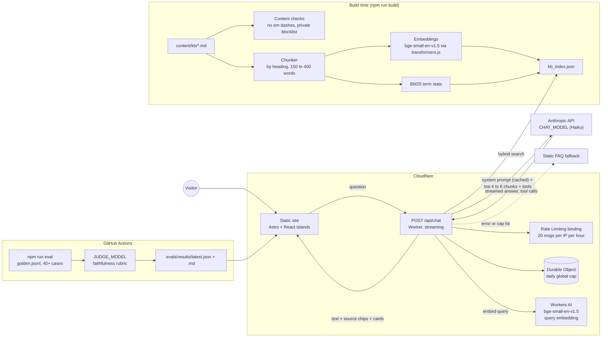

# Architecture (draft, Phase 0)

Status: proposal. Needs Taggart's sign-off before Phase 2 is built. Hosting is Cloudflare (see `docs/DECISIONS.md`).

## Overview

## Choices and reasoning

| Area | Proposal | Why |
|---|---|---|
| Frontend | **Astro with React islands**, TypeScript, Tailwind | The site is mostly static pages and case studies. Astro ships almost no JavaScript for those, which makes Lighthouse 90+ easy. React loads only for the chat and the guided demos. |
| Hosting | **Cloudflare Workers with static assets** (free plan), using the Astro Cloudflare adapter | Site and chat endpoint in one deploy, with preview URLs per branch. The domain can be bought through Cloudflare Registrar at cost. |
| Chat endpoint | One Worker route, `POST /api/chat`, streamed | Keeps the API key server-side as a Worker secret. On the free plan, time spent waiting on Anthropic doesn't count toward the 10 ms CPU limit, so streaming works. |
| Model | `CHAT_MODEL` env var, default `claude-haiku-5-5` | Fast and cheap. Swappable without code changes. |
| Retrieval | Hybrid: BM25 in plain JS, plus embeddings, with the two scores combined; top 4 to 6 chunks | Keyword matching catches names and numbers. Embeddings catch questions phrased differently. |
| Embeddings | `bge-small-en-v1.5`, computed locally with transformers.js at build time, and at query time with Workers AI's hosted copy of the same model | Running an embedding model inside a free-plan Worker isn't possible (bundle size and CPU limits). Workers AI is free at this volume. See the trade-off below. |
| Prompt caching | Cache the static system prompt and fact-sheet summary | Cuts cost and latency on every turn. |
| Rate limits | Workers Rate Limiting binding for the per-IP limit; a small Durable Object counter for the daily global cap | Built into Cloudflare. Nothing extra to sign up for. |
| Demos | In-browser guided tours on synthetic data, one shared tour component | See `docs/DECISIONS.md`. No servers to run. |
| Evals | Node script, judge model `JUDGE_MODEL` | Results committed and shown on `/evals`. |

## Trade-off: embeddings at build time vs query time

The build computes chunk embeddings locally, and the Worker embeds questions through Workers AI with the same model. The two runtimes can differ by small rounding amounts. In Phase 2 I'll check that they agree, using cosine similarity on sample texts. If they don't, the fallback is to compute build-time embeddings through the Workers AI API too, which needs a Cloudflare API token at build. If Workers AI is unavailable, retrieval drops to BM25 only, and the answer still works.

## Cost

- Cloudflare: free plan covers this traffic (100,000 Worker requests a day).
- Workers AI: free daily allowance far exceeds a portfolio's query volume.
- Anthropic: the only real cost. Capped by message limits, output-token limits, the daily cap and the spend limit Taggart sets in the console. Target under USD 10 a month.
- Domain: taggartthomson.ca, renewed at cost through Cloudflare Registrar.

## Not stored

Conversations are not stored (logging is off per `docs/DECISIONS.md`).
